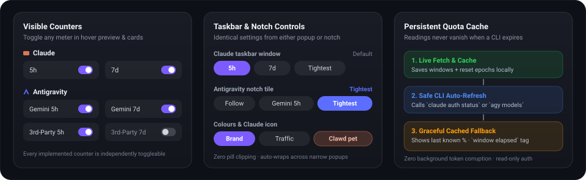

<div align="center">

# AI Usage for Fenn

**Never hit a surprise rate limit mid-flow.**  
Live **Claude**, **ChatGPT**, **Antigravity**, **Gemini**, **OpenRouter**, **GitHub Copilot**, and **Custom JSON** quotas on your Windows taskbar and floating notch.

[](#versioning)
[](https://www.python.org/)
[-2EA043?style=flat-square)](#quick-start)
[](https://fenn.click)
[](LICENSE)

<br/>


</div>

---

## Why install AI Usage?

Most developers switch between Claude Code, Codex CLI, Antigravity (`agy`), Gemini CLI, Copilot, and API keys throughout the day, only noticing a 5-hour or weekly reset cap when a prompt fails mid-task. **AI Usage** brings every quota into one native glass pill beside your system clock, with zero background bloat and zero third-party `pip` dependencies.

### What makes it click

- **Unambiguous taskbar bars**: Shows exact `% used` or `% left` right under every progress bar so you never guess which direction a bar fills.
- **Complete multi-counter hover preview**: Hover once over the taskbar pill to see **all** active buckets side by side (`5h`, `7d`, `Gemini 5h`, `Gemini 7d`, `3rd-Party 5h`, `3rd-Party 7d`, and live reset countdowns).
- **Grab-style translucent dashboard**: Both the expanded notch (`640x480`) and clicked taskbar popup (`540px`) share one cohesive frosted sidebar, full-width capsule action button, and 3 colour-tinted live stat tiles.
- **Granular per-counter toggles**: Decide in Settings which individual quota counters show on cards and hover preview (`5h`, `7d`, `Gemini 5h`, `3rd-Party 5h`, etc.), plus independent **Taskbar** and **Notch** headline pins (`5h`, `Tightest`, or `Follow`).
- **Quota persistence & safe refresh**: Safely triggers official CLI refreshes (`claude auth status`, `agy models`, Google OAuth/ADC) without corrupting single-use tokens, and preserves last known quota windows (`cached` / `window elapsed`) if a session expires or your PC goes offline.
- **Clawd pet & custom branding**: Switch Claude between its terracotta starburst logo and **Clawd pet**, pick **Brand**, **Fenn accent**, or **Traffic** colours, or drop custom icons straight onto the panel.

<div align="center">


</div>

---

## Supported providers & telemetry

| Provider | Live quotas & counters | Detection & linking |
| :--- | :--- | :--- |
| **Claude** | `5h` session, `7d` weekly, `Sonnet`, `Opus`, `Extra usage` (or monthly org USD spend) | **1-click Claude Code** (`~/.claude/.credentials.json`), auto `claude auth status` refresh, OAuth token, Admin key (`sk-ant-admin...`), or API key |
| **ChatGPT / OpenAI** | `5h` & `7d` Plus/Pro windows, `30d` free limits, `Review` quota, credits (or org USD spend) | **1-click Codex CLI** (`~/.codex/auth.json`), ChatGPT bearer JWT, or OpenAI key (`sk-...`) |
| **Antigravity** | `Gemini 5h`, `Gemini 7d`, `3rd-Party 5h`, `3rd-Party 7d`, session spend & context usage | **1-click OS keyring** (`gemini:antigravity`) + opt-in quote-free `agy statusLine` sync (`ai_usage_statusline.cmd`), auto `agy models` refresh, or GCP Project ID |
| **Gemini** | Per-model Cloud Code Assist quota bars & reset countdowns | **1-click Gemini CLI / gcloud ADC** (`~/.gemini/oauth_creds.json` or OS keyring), `GEMINI_API_KEY`, or AI Studio key (`AIza...`) |
| **OpenRouter** | Key spend cap progress, remaining credit balance, today / week / month spend | OpenRouter API key (`sk-or-v1-...`) |
| **GitHub Copilot** | `Premium`, `Chat` & `Completions` quotas + monthly reset timer | **1-click GitHub CLI** (`gh auth token`, `COPILOT_GITHUB_TOKEN`, `hosts.yml`) or GitHub token (`gho_...` / `ghp_...`) |
| **Custom JSON** | Any `% used`, `% left`, or `Used / Limit` metric with custom icon & colour | Any `https://` or `http://localhost` endpoint + dot-separated JSON path |

<details>
<summary><strong>Provider setup & troubleshooting notes</strong></summary>

1. **Claude Code (`5h` / `7d`)**: Sign in interactively inside `claude` (`/login`) so your OAuth token carries `user:profile` scope. Tokens generated by `claude setup-token` lack `user:profile` and return HTTP `403` on `/api/oauth/usage`. Admin keys (`sk-ant-admin...`) fetch monthly organisation spend instead.
2. **Antigravity (`agy`)**: Sign in via `agy` CLI or the Antigravity app, link Antigravity in **Accounts**, and click **Enable statusLine**. AI Usage configures a safe, quote-free `.cmd` wrapper (`~/.gemini/antigravity-cli/ai_usage_statusline.cmd`) that strips personal emails and transcript paths while forwarding official `remaining_fraction` buckets and reset countdowns on every turn. If an earlier quoted hook existed, AI Usage repairs it automatically on startup.
3. **ChatGPT & Codex CLI**: Run `codex login` once in terminal, then click **Link Codex CLI**. When pasting a raw ChatGPT JWT, `ChatGPT-Account-Id` and plan type are decoded automatically.
4. **Gemini CLI & Google ADC**: Supports `@google/gemini-cli` OAuth credentials, Windows keyring tokens, Google Cloud `application_default_credentials.json` refresh tokens, and `GEMINI_API_KEY` / AI Studio verification. Individual non-GCP Gemini quotas now live in **Antigravity**.
5. **Custom JSON APIs**: Use built-in presets for **DeepSeek USD** or **Local LLM %**, address nested fields with dot paths (e.g. `balance_infos.0.total_balance`), add optional `Bearer ...` or `Header: Value` headers, and click **Choose icon...** (or drag and drop any image) to attach a local PNG icon.

</details>

---

## Granular customisation (Taskbar + Notch in sync)

<div align="center">



</div>

Every control lives cleanly inside **Settings** on both the clicked taskbar popup and the expanded notch dashboard:

- **Visible Counters**: Independent toggle switches for every counter discovered on an account (e.g. show `Gemini 5h` and `Gemini 7d` while hiding `3rd-Party 7d` from hover preview and cards).
- **Shared Display & Refresh**: Switch numbers between `Used %` and `Remaining %`, pick `Brand`, `Fenn accent`, or `Traffic` colour themes, toggle `Logo` vs `Clawd pet` for Claude, set warning thresholds, and pick `2m`, `5m`, or `15m` polling.
- **Taskbar**: Display `All` accounts (up to 5 + `+N` overflow), `Tightest`, or `Hidden`; toggle reset countdown timers beneath bars; choose which window each provider pins on the taskbar.
- **Notch**: Control collapsed/expanded tile mode (`All` vs `Tightest`), independently follow or override each model's taskbar window (`Follow`, specific bucket, or `Tightest`), toggle card countdowns, warning pill badge, and auto-open on threshold cross.

---

## Quick start

Requires **Windows 10/11**, [**Fenn**](https://fenn.click), and **Python 3.8+** (`python` on `PATH`). Zero `pip install` needed.

### Install into Fenn

```powershell
git clone https://github.com/<your-username>/fenn-ai-usage.git "$env:APPDATA\Fenn\plugins\ai-usage"
```

Restart Fenn (or reload plugins in Fenn Settings), then open **Accounts** and click **Link** beside any auto-detected CLI.

### Live development workflow

Point Fenn directly to your working checkout via a directory junction and enable **Plugin dev mode** in Fenn so edits reload within a second:

```powershell
New-Item -ItemType Junction -Path "$env:APPDATA\Fenn\plugins\ai-usage" -Target "<path-to-this-repo>"
```

---

## Privacy & security guarantees

- **Local-only storage**: Settings, linked tokens, custom icons, and cached readings live exclusively in `%APPDATA%\Fenn\plugin-data\ai-usage\`.
- **Read-only CLI credential access**: Local CLI stores (`~/.claude/.credentials.json`, `~/.codex/auth.json`, `~/.gemini/oauth_creds.json`, Google ADC, and OS keyring `gemini:antigravity`) are never directly overwritten. Token refreshes call vendor CLI subcommands (`claude auth status`, `agy models`).
- **Sanitised telemetry**: `agy_statusline.py` discards emails, workspace paths, and transcript filenames before writing `antigravity_status.json`.
- **Minimal network surface**: HTTPS requests go **only** to the endpoints required for providers you explicitly link:
  - Claude: `api.anthropic.com`
  - ChatGPT / OpenAI: `chatgpt.com` or `api.openai.com`
  - Gemini: `cloudcode-pa.googleapis.com`, `oauth2.googleapis.com`, or `generativelanguage.googleapis.com`
  - GitHub Copilot: `api.github.com`
  - OpenRouter: `openrouter.ai`
  - Antigravity: local `statusLine` JSON by default (zero network calls), or `cloudcode-pa.googleapis.com` if an Enterprise GCP Project ID is provided
  - Custom: only the URL you configure

---

## Versioning

`1.0.0` marks the **initial public GitHub release**. Releases follow `MAJOR.MINOR.PATCH` Semantic Versioning:

| Digit | Release type | When it increments |
| :--- | :--- | :--- |
| **`MAJOR`** (`X.0.0`) | **Breaking release** | Incompatible changes to saved settings schemas, Fenn plugin manifest requirements, or provider configs needing manual re-linking. |
| **`MINOR`** (`1.X.0`) | **Feature release** | Backwards-compatible new AI providers, telemetry sources, UI customisation controls, or non-breaking improvements. |
| **`PATCH`** (`1.0.X`) | **Maintenance / fix release** | Backwards-compatible bug fixes, upstream parser adjustments, visual refinements, and documentation updates. |

---

## Architecture & tests

The codebase stays cleanly modular across focused pure-stdlib components:

```text
ai-usage/
├── plugin.toml              # Fenn plugin manifest & dimensions (640x480)
├── taskbar.toml             # Taskbar popup (540px) & hover preview (290px) widths
├── fenn.py                  # Official zero-dependency Fenn Python SDK
├── main.py                  # Entry point, window selection & Fenn JSON event loop
├── assets/                  # Bundled provider PNGs & vector UI showcases
├── ai_usage/
│   ├── models.py            # Normalised quota structures, presets & formatting
│   ├── http_client.py       # Stdlib HTTPS JSON client with secret redaction
│   ├── cli_auth.py          # Read-only CLI discovery, safe refresh & statusLine setup
│   ├── agy_statusline.py    # Sanitised Antigravity CLI statusLine collector
│   ├── parsers.py           # Pure stateless quota payload parsers per provider
│   ├── fetchers.py          # Live API / CLI usage fetchers & dispatch
│   ├── icons.py             # Brand PNG resolution & custom icon normalisation
│   ├── ui_canvas.py         # Frosted sidebar, capsule CTA & colour-tinted tile canvases
│   ├── compact_views.py     # Taskbar pill, hover preview, notch tiles & right-click menu
│   ├── account_views.py     # Usage cards, CLI auto-detect rows & connect forms
│   ├── settings_views.py    # Visible counters, display, taskbar & notch controls
│   ├── views.py             # Top-level Grab-style page & popup orchestrator
│   └── state.py             # Settings, persistent cache & background polling
├── tests/
│   └── test_plugin.py       # Unit, parser, persistence & live protocol test suite
└── LICENSE
```

Run the full test suite anytime:

```powershell
python -m unittest discover -s tests -v
```

<div align="center">

Licensed under the [MIT Licence](LICENSE). Built with pure Python stdlib for [Fenn](https://fenn.click).

</div>
